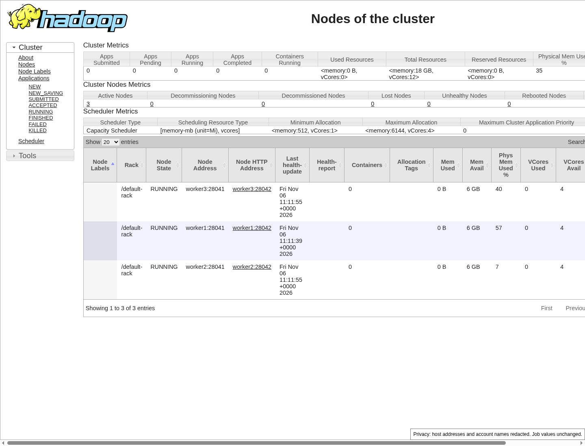
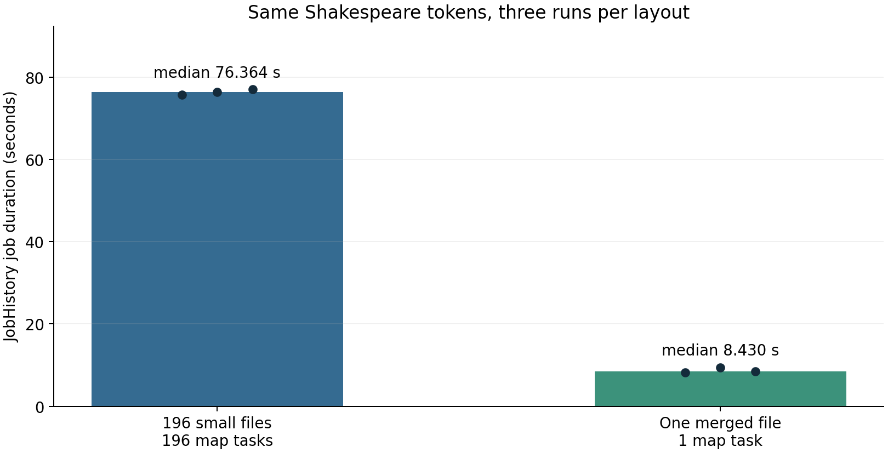
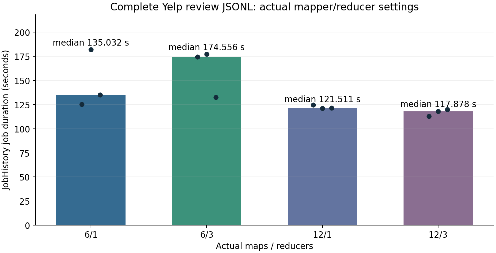
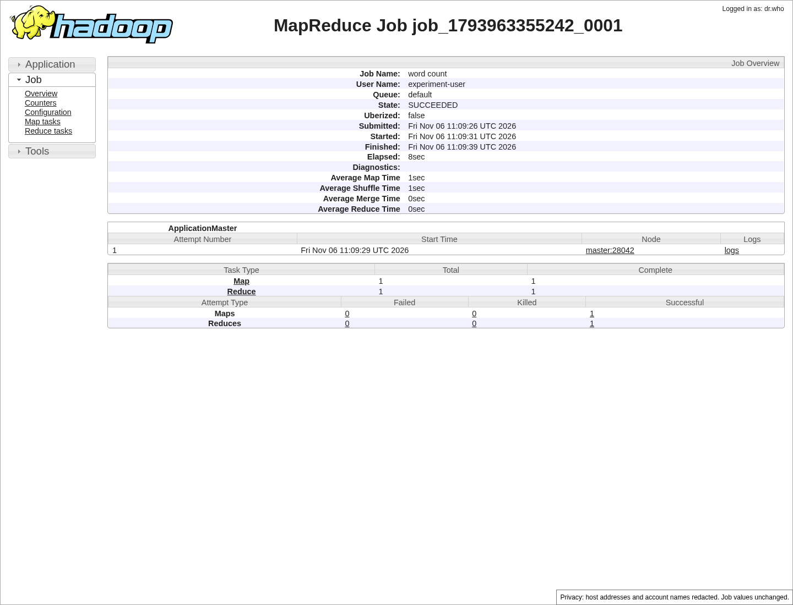
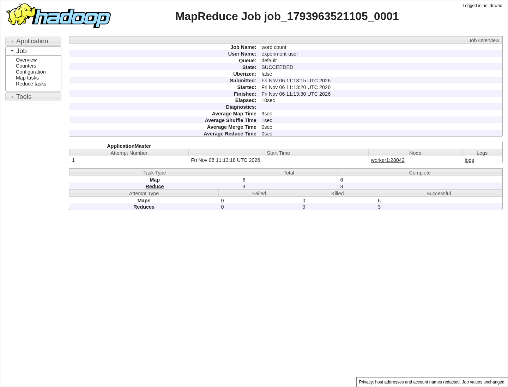
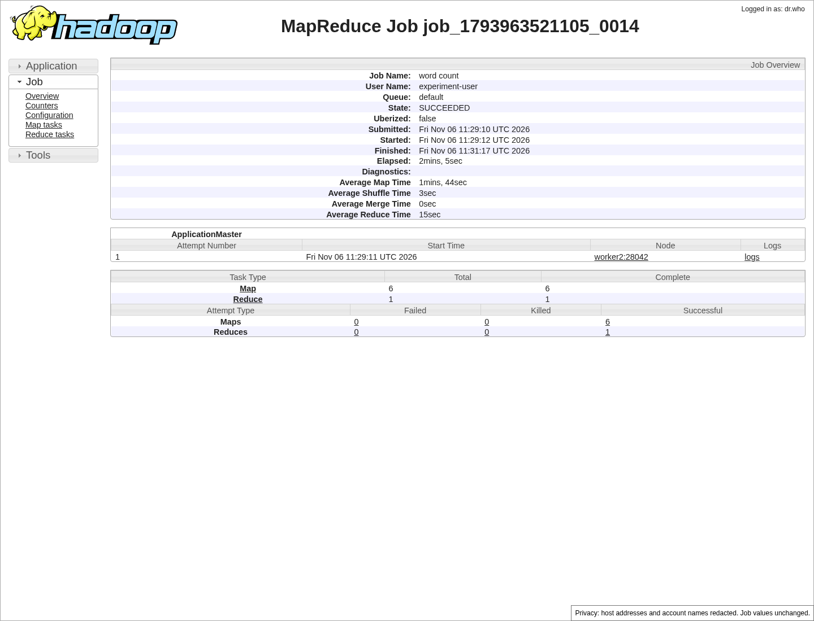

# Homework 1 - Hadoop and Common-Followee Top-10

**Four physical laboratory machines | Actual HDFS/YARN experiments, 6 November 2026**

Name: ____________________    SID: ____________________

**Completed experiment.** Four independent single-node WordCount checks, a Thor master with three physical workers, the three-repetition Shakespeare comparison, four actual Yelp mapper/reducer configurations, and all six medium-graph jobs were executed successfully. The full medium result covers 81,306 users; 1,000 independent sampled rankings and all reference rankings agree. Every performance value below comes from completed jobs in this run, not the earlier LocalJobRunner results.

**Environment choice.** The student selected laboratory hardware in place of the assignment's cloud VMs/course cluster. These measurements demonstrate the laboratory deployment and do not claim that the instructor formally approved that substitution. GPUs do not execute these Hadoop jobs. The optional large-graph bonus is reported separately; it is not included in the completed mandatory result.

**Authorship and acknowledgment.** Implementation, deployment, verification and this report used ChatGPT/Codex assistance. The student must check the course policy, acknowledge actual discussions and sources, fill in personal information, and personally verify any declaration before signing. No identity, signature or originality assertion has been supplied by the assistant.

## 1. Hardware, software and fixed resources

The topology consists of four independent physical hosts, not four NUMA domains. The H800 host has two CPU sockets/NUMA nodes but remains one worker. All hosts use Hadoop 3.3.6, architecture-matched Amazon Corretto JDK 11.0.33.0.10, and Python 3. Public evidence uses role labels; network addresses and account identifiers remain in the ignored local evidence.

| Node | CPU / architecture | RAM (GiB) | OS | Hadoop role |
|---|---|---|---|---|
| master | Thor / aarch64 (14 logical CPUs) | 122.8 | Ubuntu 24.04.3 LTS | NN, SNN, RM, History |
| worker1 | Xeon Gold 6342 CPU @ 2.80GHz / x86_64 | 251.3 | Ubuntu 22.04.5 LTS | DN + NM |
| worker2 | Core Ultra 7 265K / x86_64 | 62.2 | Ubuntu 26.04 LTS | DN + NM |
| worker3 | Core Ultra 7 265K / x86_64 | 62.2 | Ubuntu 26.04 LTS | DN + NM |

Each worker advertises 6,144 MiB and 4 YARN vcores. Map/reduce containers request 1,536 MiB with 768 MiB heap; the ApplicationMaster requests 1,536 MiB with 1,024 MiB heap. NodeManagers and their child containers inherit four-CPU affinity: worker1 80-83; workers2/3 16-19. The cluster therefore has 18,432 MiB and 12 advertised vcores. These are experiment allocations, not the total host resources. Map/reduce speculation is disabled. Map output uses DefaultCodec compression. HDFS replication is three with 128 MiB blocks. Worker quotas, input and task heap were fixed before the comparisons.

Hadoop packages passed official Apache SHA-512 checks and both JDK packages passed vendor SHA-256 checks. Native libhadoop and zlib loaded on all four hosts. Optional OpenSSL, ISA-L and PMDK were absent; no assessed operation required them. The system's default Java, GPU software, network configuration and other users' workloads were not changed.

Every experiment uses dedicated configuration, PID, checkpoint, log and storage directories. All fixed service ports have offset 20000 to avoid existing services. A per-JVM hosts file resolves the four nodes consistently without editing system DNS. Single-node daemons were stopped before the new multi-node namespace was formatted once. Thor runs management services only; each other physical host runs one DataNode and one NodeManager.

The hosts are shared. An official Yelp download to worker1 remained active during the Shakespeare runs; this is an I/O limitation of that comparison. No competing Hadoop job was submitted. The Yelp comparison began only after its complete input had been downloaded and extracted. These are small repeated observations on this particular heterogeneous laboratory cluster, not universal hardware performance claims.

---PAGE---

## 2. Q1(a): independent single-node checks and cluster acceptance

Each physical host first ran its own fresh HDFS/YARN namespace with replication one. H800 initially used its existing OpenJDK 11.0.27 runtime; the remote single-node checks used Corretto 11.0.33. All four hosts were normalized to Corretto 11.0.33 before the measured multi-node experiments. The built-in WordCount input was `hello hadoop` and `hello mapreduce` on separate lines. Every result was exactly hadoop=1, hello=2, mapreduce=1. Successful History pages, service/version logs and original JSON were retained.

| Physical node | Single-node job ID | Result | Actual M/R |
|---|---|---|---|
| master | job_1793963355242_0001 | SUCCEEDED | 1 / 1 |
| worker1 | job_1793962962220_0002 | SUCCEEDED | 1 / 1 |
| worker2 | job_1793963323157_0001 | SUCCEEDED | 1 / 1 |
| worker3 | job_1793963323227_0001 | SUCCEEDED | 1 / 1 |

The multi-node acceptance showed exactly three Live DataNodes and three RUNNING NodeManagers. A separate six-input-file WordCount used six maps and three reducers; output was hadoop=6, hello=12, mapreduce=6. History recorded successful tasks on all three workers, confirming cross-host execution. The smoke job is not included in the benchmark tables.



---PAGE---

## 3. Q1(b): Shakespeare small files versus merged input

The assignment archive was downloaded again and prepared as 196 text files and one 6,460,189-byte merged file. Every nonempty source file has a trailing newline in both layouts. There is no sampling or repeated expansion. The two layouts therefore contain the identical token stream. Both use the same built-in WordCount, cluster configuration and one reducer. Their order alternates small/merged, merged/small, small/merged.

| Layout | Rep | Actual maps | Reducers | Job seconds |
|---|---|---|---|---|
| small | 1 | 196 | 1 | 75.648 |
| merged | 1 | 1 | 1 | 8.241 |
| merged | 2 | 1 | 1 | 9.459 |
| small | 2 | 196 | 1 | 76.364 |
| small | 3 | 196 | 1 | 77.015 |
| merged | 3 | 1 | 1 | 8.430 |

Median job time is **76.364 s** for small files and **8.430 s** for the merged file. The observed median speedup is **9.06x**. All six canonical output hashes equal `b9524c8e2c10b2b16d2e5334f34dc3384cb7c46b47f2a770c023d54cae877d31`, matching the independent archived reference containing 72,379 distinct tokens.

The small layout creates 196 short map tasks; the merged input creates one. In these measurements, reduced scheduling/JVM startup overhead outweighed the loss of map parallelism. The small-file reducers overlap the map phase and include waiting for shuffle input, so their elapsed times should not be added to the maps' times. Single-map placement varies across the heterogeneous workers and contributes to the merged-run spread. Shared disk/network activity and caching were not independently controlled.



---PAGE---

## 4. Q1(c): complete Yelp input and measured task times

The official ZIP was downloaded completely and only its review JSONL was extracted. Input is the full **5,341,868,833-byte** uncompressed review file, SHA-256 `a4edc050d14eec25373a75e7ee211d42f49f14f47230837d8c7849eb9c5f2f96`. The file is counted as JSONL text, including field names and identifiers; it is not a text-field-only transform, sample, synthetic expansion or unsplittable gzip input. Every setting reads the identical HDFS file.

The runner fixes both split bounds to ceil(input bytes / target maps). Actual M/R counts are verified from History, rather than trusting a requested mapper count. Times below are seconds; each row is a real successful job. Map/reduce max, min and mean use completed task finishTime-startTime; reducer time includes shuffle, sort and reduce. Job duration is job.finishTime-job.startTime. Parallel task durations are not summed to obtain job duration. The preserved CSV has separate columns for all seven required statistics, actual M/R, job IDs and output hashes.

| Actual M/R | Rep | Map max | Map min | Map mean | Reduce max | Reduce min | Reduce mean | Job |
|---|---|---|---|---|---|---|---|---|
| 6/1 | 1 | 104.930 | 101.226 | 104.026 | 18.927 | 18.927 | 18.927 | 125.302 |
| 6/3 | 1 | 150.581 | 99.485 | 124.971 | 70.113 | 69.791 | 69.967 | 174.556 |
| 12/1 | 1 | 82.221 | 42.613 | 63.507 | 66.405 | 66.405 | 66.405 | 124.663 |
| 12/3 | 1 | 81.477 | 42.423 | 63.102 | 55.632 | 51.999 | 53.487 | 112.895 |
| 12/3 | 2 | 76.066 | 43.980 | 61.122 | 55.510 | 53.722 | 54.675 | 117.878 |
| 12/1 | 2 | 86.378 | 42.513 | 63.730 | 65.991 | 65.991 | 65.991 | 121.256 |
| 6/3 | 2 | 159.126 | 102.071 | 125.874 | 71.035 | 68.308 | 69.671 | 177.431 |
| 6/1 | 2 | 157.771 | 103.499 | 126.761 | 73.560 | 73.560 | 73.560 | 181.993 |
| 6/1 | 3 | 115.258 | 97.107 | 108.622 | 33.731 | 33.731 | 33.731 | 135.032 |
| 6/3 | 3 | 103.960 | 101.457 | 102.722 | 26.283 | 19.533 | 21.867 | 132.654 |
| 12/1 | 3 | 83.623 | 42.915 | 63.738 | 65.260 | 65.260 | 65.260 | 121.511 |
| 12/3 | 3 | 79.661 | 43.603 | 61.223 | 57.494 | 56.765 | 57.176 | 119.886 |

All Yelp output hashes agree: `841320a7bf34efe2546c6efb85d4a87a2556795e28ae6871e017bde7deec6224`. There are no failed map or reduce attempts in the reported jobs.

Each setting has 3 successful repetitions. Observed median job durations by setting: 6/1 135.032 s, 6/3 174.556 s, 12/1 121.511 s, 12/3 117.878 s. The fastest observed setting is 12/3, while 6/3 is slowest. More maps expose additional parallel tasks while increasing startup and spill/sort work; more reducers distribute distinct-key aggregation but increase shuffle fan-out. The measurements and task-duration spread, not the requested counts alone, determine the observed ordering. Three repetitions expose variation in elapsed time and task placement. All individual runs are retained; these measurements describe this shared heterogeneous cluster, and do not establish a hardware-independent causal effect.

The first 6/1 job placed its six maps on workers2/3 (three each); the first 6/3 job used workers1/3 (three each). The first two 12-map jobs used four maps per worker. The H800 host is a Xeon CPU worker and has longer map elapsed times than the Core Ultra workers in those jobs. Consequently the observed settings also differ in task placement on heterogeneous CPUs. This is a measured placement effect and a limit on causal interpretation of mapper/reducer counts alone; task-placement.json and raw attempts preserve the evidence.



---PAGE---

## 5. Q2: graph interpretation and exact ranking

For user u, let F(u) be the set of users that u follows. The required similarity is `s(u,v) = |F(u) intersection F(v)|`, excluding u = v. This is common-followee similarity: it must not be accidentally implemented as common-follower similarity or replaced by Jaccard, cosine similarity or a graph clustering method.

For each followee f, define L(f) as its distinct followers. Every unordered pair from L(f) contributes one to that pair's similarity. Summing these contributions over all followees gives the required intersection count.

**Observed course input.** The actual Dropbox file at assignment reference [7] was downloaded successfully. It contains a two-column numeric edge list with 2,420,766 nonblank edge lines, 1,768,149 distinct directed edges and 81,306 distinct endpoint IDs. There are 652,617 duplicate edge lines beyond the unique directed edges. Its compressed size is 10,621,918 bytes. This differs from the assignment prose describing about 2.5 million users. The count was obtained by deduplicating ordered edges with a disk-backed SQLite primary key and counting the union of endpoints. It is not an estimate.

The file's compressed SHA-256 is:

```text
d9f99b0e6a53b9204b8c215f41b3c10fb99a1e1e783858c012b06d0d3d4bd129
```

The parser also accepts the assignment's `followee:followers` representation. For edge lists, the first column is assumed to be the follower unless `--edge-order followee-follower` is specified. The SNAP readme defines a Twitter/Gplus edge a b as a following b [9], supporting this convention. Format auto-detection alone cannot establish direction; a different course file would need its own direction check. The observed node/unique-edge counts agree with the public SNAP Twitter description [7], but no alternate download was substituted for the course URL.

All endpoints and empty adjacency-list heads are included in the user universe. Duplicate edges are removed before counting. Numeric IDs use Python arbitrary-precision integers. Ties are broken by increasing numeric ID, and a user never recommends itself.

The assignment does not specify how to resolve ties or users with fewer than ten positive-similarity candidates. The explicit convention used here is to fill remaining positions with zero-similarity users in increasing ID order, producing `min(10, N-1)` distinct candidates per user. This policy should be stated in the final report and checked against any course clarification.

---PAGE---

## 6. Q2: six MapReduce stages

| Job | Mapper/reducer operation | Output |
|---|---|---|
| 01 | Normalize edges, retain users, deduplicate composite edge keys | Unique edges and user markers |
| 02 | Keep local then global smallest K+1 user IDs | Tiny universe side file |
| 03 | Group by followee, spool followers into B-user blocks | Block payloads with block counts |
| 04 | Replicate blocks to block-pair keys and enumerate pairs | One unordered-pair contribution per shared followee |
| 05 | Sum contributions by unordered user pair | Exact positive similarity scores |
| 06 | Emit scores in both directions, secondary-sort and take K | All-user Top-10 records |

Stage 01 keys are `(E, followee, follower)` or `(U, user, marker)`. The dedup reducer is also safe as a combiner: repeated application produces the same unique records. User markers ensure that users without positive-similarity partners are retained.

For jobs 01 and 05, `stream.num.reduce.output.key.fields=3` is explicitly set so a Streaming combiner preserves the full composite key. Omitting it can corrupt merge ordering across spills and invalidate deduplication or pair summation.

Stage 03 partitions on `(kind, followee)` and uses the full composite key for sorting. One followee's follower blocks are spooled to a temporary disk file. Its full follower list is not retained in reducer memory. Once the block count is known, records are emitted with the count required by the next stage.

Stage 04 routes block i to every unordered block-pair `(min(i,j), max(i,j))`. A diagonal pair receives one block; an off-diagonal pair receives left and right blocks. The partition key is `(P, followee, left_block, right_block)` and the side is an additional sorting field. A reducer processes at most two B-user blocks at a time. Diagonal groups emit combinations within a block; off-diagonal groups emit the Cartesian product. This covers every follower pair once for that followee.

Stage 05 partitions on the full unordered-pair key and sums integer contributions. Its sum combiner reduces repeated pair traffic where possible without changing the result. It never combines incomplete rankings or drops candidates before their total score is known.

Stage 06 emits `(u, -score, v)` and `(v, -score, u)` as composite keys. KeyFieldBasedPartitioner uses only u; KeyFieldBasedComparator sorts numerically by u, negative score and candidate ID. Thus all candidates for one user reach the same reducer in the required order [8]. The reducer retains only K positive candidates and fills any missing positions using the tiny universe file. Final records have the specified `user:id id ...` format without score fields.

---PAGE---

## 7. Q2: correctness and scaling analysis

**Similarity correctness.** After deduplication, an edge appears once. For a fixed followee f, distinct followers are divided into disjoint blocks. Every distinct follower pair lies either within exactly one block or across exactly one unordered pair of blocks. Stage 04 therefore emits exactly one contribution for that pair and f. Stage 05 sums one contribution for every common followee, giving `|F(u) intersection F(v)|`.

**Top-K correctness.** Each positive score is sent to both endpoints. All records for a user are co-partitioned and sorted by decreasing score and then increasing candidate ID. The first K positive candidates are therefore the exact positive-score ranking prefix. No candidate is truncated before pairwise summation.

**Zero padding and every-user correctness.** Each user has a marker even when it has no positive candidates. If p < K positive candidates were retained, the globally smallest K+1 IDs contain at least K-p IDs other than the user and those p candidates, unless the entire graph has fewer than K+1 users. In that case they contain all users. Selecting unused IDs in increasing order therefore supplies exactly the correct zero-score suffix, without an N-by-N zero-pair expansion.

Let E be the number of unique edges, d_f the follower count of f, and `C = sum_f d_f*(d_f-1)/2`. Stage 04 emits C pair contributions. Its CPU/output work is O(C), and exact pair enumeration can be expensive even when the input itself is small. For the observed medium file, assuming first-column follower semantics, the maximum d_f is 3,383 and C is **154,933,408**.

With `k_f = ceil(d_f/B)`, the block-replication stage moves `sum_f d_f*k_f` follower-ID occurrences. Smaller B distributes heavy-followee work into more, smaller groups, but increases replication overhead. Pair reducers use O(B) IDs per group; block construction also uses O(B) buffered IDs plus O(d_f) temporary disk storage for the active followee. Parsing an original adjacency line additionally requires memory proportional to that line's length. Top-K reducers use O(K) candidate memory. Shuffle/sort storage remains external to these Python state bounds.

Map-output compression is enabled. This compresses shuffle/spill output, not all HDFS stage files. Input/output checks, available-disk monitoring and Hadoop counters remain necessary. `STOP_AFTER_BLOCKS=1` allows an explicit capacity checkpoint before pair enumeration; `RESUME_AFTER_BLOCKS=1` continues from it. Blocking improves memory bounds and load distribution but does not guarantee that arbitrary graphs fit small VMs or finish within a fixed time.

---PAGE---

## 8. Actual medium-graph execution, validation and suffix outputs

All six stages below were executed on this four-physical-host HDFS/YARN cluster. Stage 03 capacity counters were checked before pair enumeration; the actual candidate-pair count is 154,933,408. Available worker disks had sufficient headroom for the medium intermediates. The older LocalJobRunner run remains a separately identified reference and supplies no timings to this table.

| Stage | Job ID | Maps | Reducers | Job seconds |
|---|---|---|---|---|
| 01_dedup | job_1793963521105_0008 | 2 | 6 | 16.669 |
| 02_universe | job_1793963521105_0009 | 6 | 1 | 8.281 |
| 03_blocks | job_1793963521105_0010 | 6 | 6 | 13.345 |
| 04_pairs | job_1793963521105_0011 | 6 | 6 | 38.374 |
| 05_scores | job_1793963521105_0012 | 29 | 6 | 118.407 |
| 06_top10 | job_1793963521105_0013 | 12 | 6 | 112.363 |

The new merged output has **81,306** users, ten distinct non-self candidates per user, and exact input-user coverage. An independent followee-set/inverted-index oracle recomputed **1,000** fixed-seed sampled users: **zero ranking mismatches**. Exact per-user comparison against all 81,306 archived rankings also found zero missing users, extra users or changed rankings. User-line ordering across part files is ignored; candidate ordering is not.

The new full-output SHA-256 is `cb6d2f7776b031314f648996bf24392774388eea261befca077172c5aaf4899f`. Its bytes can differ from the older output solely because reducer/part ordering differs; semantic comparison is the appropriate full-result check.

Suffix filtering occurs after computing every user's result. Because no student-ID suffix was supplied, all 1,000 subsets 000.txt through 999.txt are exported and archived with the new all-user result. Select the three-digit suffix matching the student's SID; no full SID is needed for computation. The optional large-graph bonus has not been completed and no bonus result is claimed.

The implementation additionally passes 18 semantic/timing/configuration/download tests, including 100 fixed-seed random graphs, duplicate edges, isolated/followee-only users, ties, zero-score padding, leading zeros, large integer IDs and high-degree blocking. These tests supplement the real cluster evidence and are not benchmark measurements.

---PAGE---

## 9. Evidence and repeatability

| Evidence | Repository path relative to homework1 |
|---|---|
| Actual timings, raw job/tasks/counters/attempts | evidence/lab-20261106T110350Z/ |
| Environment, runtime checksums, input manifests | evidence/lab-20261106T110350Z/ |
| Real service screenshots with access identifiers redacted | evidence/lab-20261106T110350Z/screenshots/ |
| Independent validation and full-reference comparison | evidence/lab-20261106T110350Z/community/ |
| All-user output and 1,000 suffixes | artifacts/ (files named with lab-20261106T110350Z) |
The public JSON/log copies redact only host addresses and account identifiers. Original unredacted logs, exact configuration/commands and machine inventory remain in the ignored .local/results directories. Job IDs, timestamps, counters, task states, outputs and timing values are preserved. Screenshots come from actual running Hadoop pages; a visible privacy note identifies the label redaction.

The successful cluster smoke ran on every worker. Public task-attempt data records actual task placement for each benchmark. Exact command arrays, split sizes and return states are retained alongside the successful jobs. Dedicated runtime directories permit inspection without altering other services or reformatting existing HDFS. Any failed preparation attempts are retained locally and described in the work log; they are excluded from successful measurement tables.

| Setting / stage | Completed job ID |
|---|---|
| small rep 1 | job_1793963521105_0002 |
| merged rep 1 | job_1793963521105_0003 |
| merged rep 2 | job_1793963521105_0004 |
| small rep 2 | job_1793963521105_0005 |
| small rep 3 | job_1793963521105_0006 |
| merged rep 3 | job_1793963521105_0007 |
| m6_r1 rep 1 | job_1793963521105_0014 |
| m6_r3 rep 1 | job_1793963521105_0015 |
| m12_r1 rep 1 | job_1793963521105_0016 |
| m12_r3 rep 1 | job_1793963521105_0017 |
| m12_r3 rep 2 | job_1793963521105_0018 |
| m12_r1 rep 2 | job_1793963521105_0019 |
| m6_r3 rep 2 | job_1793963521105_0020 |
| m6_r1 rep 2 | job_1793963521105_0021 |
| m6_r1 rep 3 | job_1793963521105_0022 |
| m6_r3 rep 3 | job_1793963521105_0023 |
| m12_r1 rep 3 | job_1793963521105_0024 |
| m12_r3 rep 3 | job_1793963521105_0025 |

---PAGE---

## 10. Actual screenshots









---PAGE---

## References and source acknowledgment

The uploaded Homework 1 PDF is the source of the question, marking scheme, output format and deadline. The supplied implementation, analysis and report use ChatGPT/Codex assistance as stated on the cover. The final submission should separately list actual human discussions and any additional sources used by the student.

[1] Apache Software Foundation. Hadoop Java Versions. https://cwiki.apache.org/confluence/pages/viewpage.action?pageId=421957808

[2] Apache Hadoop 3.3.6. Single Node Setup. https://hadoop.apache.org/docs/r3.3.6/hadoop-project-dist/hadoop-common/SingleCluster.html

[3] Apache Hadoop 3.3.6. Cluster Setup. https://hadoop.apache.org/docs/r3.3.6/hadoop-project-dist/hadoop-common/ClusterSetup.html

[4] Course Tutorial 2. Single-node Hadoop, WordCount, and secondary sort. https://xuhappy.github.io/courses/BigData/tutorial/tutorial2/

[5] Yelp Open Dataset. https://www.yelp.com/dataset

[6] Apache Hadoop 3.3.6. MapReduce History Server REST APIs. https://hadoop.apache.org/docs/r3.3.6/hadoop-mapreduce-client/hadoop-mapreduce-client-hs/HistoryServerRest.html

[7] Stanford SNAP. Social circles: Twitter. https://snap.stanford.edu/data/ego-Twitter.html . Used to cross-check the observed course-file node/unique-edge counts, not as a replacement download.

[8] Apache Hadoop 3.3.6. Hadoop Streaming. https://hadoop.apache.org/docs/r3.3.6/hadoop-streaming/HadoopStreaming.html

[9] Stanford SNAP. Ego-network dataset readme (edge-direction convention). https://snap.stanford.edu/data/readme-Ego.txt

The course Dropbox file was downloaded and hash-checked again; SNAP is used to corroborate its observed size and direction, not as a silent replacement. Amazon Corretto download and checksum documentation: https://docs.aws.amazon.com/corretto/latest/corretto-11-ug/downloads-list.html

---PAGE---

## Student declaration - to be completed personally

The following is the declaration required by the uploaded assignment. It is included as an unsigned form. The student must ensure that it accurately describes the final work and that the course's independent-work and source-disclosure requirements have been met before signing. This draft is explicitly AI-assisted.

I declare that the assignment submitted is original except for source material explicitly acknowledged, and that the same or related material has not been previously submitted for another course. I also acknowledge that I am aware of University policy and regulations on honesty in academic work, and of the disciplinary guidelines and procedures applicable to breaches of such policy and regulations.

Signed (Student): ________________________________________

Date: __________________________________________________

Name: __________________________________________________

SID: ___________________________________________________

Names of people actually consulted or worked with:

________________________________________________________

External material and AI assistance actually used, subject to course policy:

________________________________________________________

________________________________________________________
